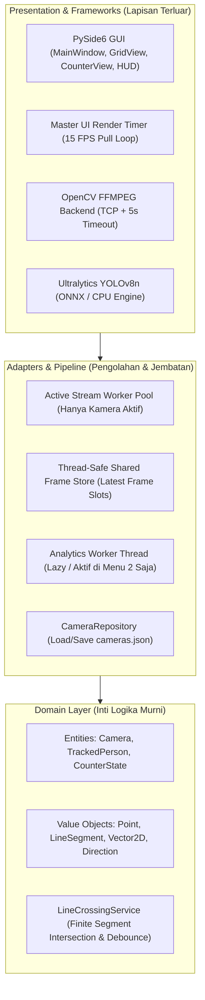
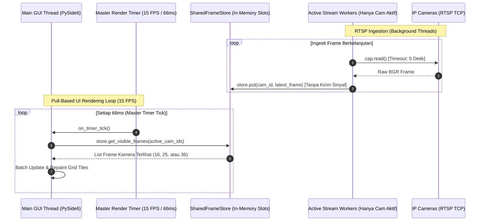

# SYSTEM ARCHITECTURE & LEAN CLEAN ARCHITECTURE BLUEPRINT

**Proyek**: ManyPlayer - Windows Multi-Camera RTSP Monitoring & AI People Counter  
**Target Platform**: Windows 10 & Windows 11 (64-bit Desktop Application)  
**Pola Arsitektur**: **Lean Clean Architecture (Pragmatic Domain-Driven)**  
**Dokumen Versi**: 2.1 (Hardened & Lean Standard)  
**Tanggal**: 25 Oktober 2026  
**Status**: Approved Architecture  

---

## 1. Prinsip Utama: Lean & Clean Architecture

Sistem ManyPlayer menerapkan **Lean Clean Architecture**:
1. **Domain Murni (100% Testable)**: Logika matematika geometri garis lintasan (*finite segment crossing*), penentuan arah (*vector math*), dan status hitungan (*counter state*) tidak memiliki ketergantungan pada pustaka luar (murni Python standar).
2. **Lean & Pragmatis**: Menghindari abstraksi palsu (*over-abstraction / single-use interfaces*). Komponen yang hanya memiliki 1 implementasi (seperti pembaca file JSON atau pelacak ByteTrack) dibuat langsung tanpa lapisan *interface* semu, menghemat lebih dari 180 baris kode *boilerplate*.
3. **Isolasi Antarmuka (GUI Decoupling)**: Lapisan antarmuka PySide6 hanya merender gambar dan menangkap klik pengguna, tanpa logika bisnis atau perhitungan geometri.



---

## 2. Model Threading & Pull-Based Rendering (Solusi Anti-Freeze)

> [!CAUTION]
> **Pencegahan UI Freeze pada 36 Kamera**:
> Jangan pernah memancarkan sinyal Qt per frame dari 36 thread (36 × 15 FPS = **540 sinyal/detik**). Hal tersebut akan membombardir Qt Event Loop dan membuat Windows menandai aplikasi sebagai *"Not Responding"*.
>
> **Solusi Standar Industri (Pull-Based Rendering)**:
> 1. Setiap `StreamWorker` menyimpan frame gambar BGR terbaru langsung ke dalam slot memori array `SharedFrameStore[camera_id]`.
> 2. Thread GUI menggunakan **1 buah Master `QTimer` terpusat** yang berdetak setiap 66 ms (15 FPS).
> 3. Saat timer berdetak, GUI hanya menarik (*pull*) frame dari kamera-kamera yang sedang **tampil di layar**, mengonversinya ke format Qt, dan menggambarnya sekaligus.



---

## 3. Manajemen Beban Dinamis (Active Camera Throttling)

Untuk mencegah pemborosan CPU dan memori:
* **Mode 4x4 (16 Kamera)**: Sistem hanya menyalakan worker untuk Kamera 1 sampai 16. Kamera 17 sampai 36 berada dalam status **OFF / DISCONNECTED**.
* **Mode 5x5 (25 Kamera)**: Menyalakan Kamera 1 sampai 25.
* **Mode 6x6 (36 Kamera)**: Menyalakan seluruh 36 kamera.
* **Saat Beralih ke Menu 2 (People Counter)**: Seluruh thread grid di-pause, dan hanya 1 atau 2 kamera analitik yang diaktifkan dengan resolusi jernih.

---

## 4. Ketahanan Jaringan RTSP Windows (Anti-Hang Socket Timeout)

Pada Windows, fungsi `cv2.VideoCapture` default dapat mengalami *blocking* hingga 30 detik jika sebuah kamera IP mati listrik. Untuk mengatasinya, konfigurasi socket timeout wajib disetel secara eksplisit:

```python
# Standar Konfigurasi RTSP ManyPlayer
import os
os.environ["OPENCV_FFMPEG_CAPTURE_OPTIONS"] = (
    "rtsp_transport;tcp|"      # Mencegah artefak grey screen akibat packet loss UDP
    "stimeout;5000000|"        # Timeout socket 5.000.000 mikrodetik = 5 detik (Anti-hang)
    "max_delay;500000"         # Batas buffer delay 0.5 detik (Zero Latency)
)
```

Dengan konfigurasi ini, jika kabel kamera dicabut, worker akan mendeteksi status terputus dalam 5 detik dan mencoba menyambung ulang (*auto-reconnect*) tanpa membuat aplikasi membeku.

---

## 5. Algoritma Garis Lintasan (Finite Line Segment Intersection)

> [!IMPORTANT]
> **Perbaikan Logika Garis**:
> Evaluasi tidak boleh menggunakan garis tak hingga (*infinite line*). Sistem wajib memvalidasi bahwa segmen gerak kaki seseorang **benar-benar memotong segmen garis virtual** di antara titik ujung $P_1$ dan $P_2$.

```
           [Area Luar / Sebelum Garis]
                       │
                       ▼ Gerak Kaki (C_prev -> C_curr)
      P1 ══════════════╪══════════════ P2   (Segmen Garis Virtual Kusen Pintu)
                       │
                       ▼ 
           [Area Dalam / Sesudah Garis]
```

### Rumus Perpotongan Dua Segmen Garis:
Dua buah segmen garis:
* Segmen Garis Virtual: $S_1 = (P_1, P_2)$
* Segmen Gerak Seseorang: $S_2 = (C_{prev}, C_{curr})$

Dua segmen ini berpotongan jika dan hanya jika orientasi titik-titiknya saling berlawanan (*Counter-Clockwise Test*):

$$\text{CCW}(A, B, C) = (B_x - A_x)(C_y - A_y) - (B_y - A_y)(C_x - A_x)$$

Kondisi Berpotongan:
$$\text{CCW}(P_1, P_2, C_{prev}) \times \text{CCW}(P_1, P_2, C_{curr}) < 0$$
$$\text{DAN}$$
$$\text{CCW}(C_{prev}, C_{curr}, P_1) \times \text{CCW}(C_{prev}, C_{curr}, P_2) < 0$$

### Penentuan Arah (Masuk vs Keluar):
Jika kedua segmen terbukti berpotongan, arah ditentukan dari tanda *Cross Product* pergerakan:
$$\text{Arah} = (P_{2x} - P_{1x})(C_{curry} - C_{prevy}) - (P_{2y} - P_{1y})(C_{currx} - C_{prevx})$$
* $\text{Arah} > 0 \rightarrow$ **MASUK (+1)**
* $\text{Arah} < 0 \rightarrow$ **KELUAR (+1)**

Orang yang melangkah di luar koordinat $P_1$ atau $P_2$ (di samping pintu) **tidak akan berpotongan**, sehingga tidak terjadi hitungan palsu.

---

## 6. Struktur Direktori Proyek (Lean Clean Architecture)

Struktur kode dirampingkan dari boilerplate berlebih, menjaga jumlah file tetap ringkas namun fungsionalitas dan domain murni tetap terjaga:

```
manyplayer/
├── DOCS/
│   ├── BRD.md
│   ├── PRD.md
│   ├── ARCHITECTURE.md             # Dokumen Arsitektur Versi 2.1 Ini
│   ├── WORKFLOW.md                 # Standar Operasional Siklus Pengembangan
│   └── TODO.md                     # Pelacak Progres Otomatis
│
├── config/
│   └── cameras.json                # Daftar URL RTSP & Pengaturan
│
├── src/
│   ├── domain/                     # DOMAIN LAYER (Pure Python - 0 External Imports)
│   │   ├── __init__.py
│   │   ├── geometry.py             # Point, Segment, CCW & Segment Intersection Math
│   │   ├── entities.py             # Camera, TrackedPerson, CounterState
│   │   └── crossing_service.py     # Logika Tripwire Crossing & Debounce
│   │
│   ├── core/                       # INGESTION & PIPELINE (Adapters Video & AI)
│   │   ├── __init__.py
│   │   ├── camera_store.py         # Membaca & Menyimpan cameras.json
│   │   ├── frame_store.py          # SharedFrameStore (In-memory latest slots)
│   │   ├── stream_worker.py        # OpenCV VideoCapture Worker (TCP + 5s Timeout)
│   │   ├── worker_pool.py          # Active Camera Manager (16 / 25 / 36 Throttling)
│   │   ├── ai_detector.py          # YOLOv8n Object Detector (Person Class)
│   │   └── ai_tracker.py           # ByteTrack Object Tracker
│   │
│   ├── presentation/               # PRESENTATION LAYER (PySide6 Native Windows)
│   │   ├── __init__.py
│   │   ├── main_window.py          # Shell Jendela Utama & Tab Navigation
│   │   ├── grid_view.py            # Menu 1: Grid 16 (4x4), 25 (5x5), 36 (6x6)
│   │   ├── counter_view.py         # Menu 2: People Counter Split View
│   │   └── widgets/
│   │       ├── video_tile.py       # Sel Video Penampil Frame
│   │       └── hud_overlay.py      # Gambar Garis & Kotak Angka HUD
│   │
│   └── main.py                     # Entry Point & Composition Root
│
├── tests/                          # AUTOMATED TESTS
│   ├── unit/
│   │   ├── test_geometry.py        # Pengujian Matematika Perpotongan Garis
│   │   ├── test_crossing.py        # Pengujian In/Out Counter & Debounce
│   │   └── test_camera_store.py    # Pengujian Format JSON Kamera
│   └── mock_stream.py              # Simulator Video Feed Lokal untuk Testing
│
└── requirements.txt
```

---

## 7. Rangkuman Penyelesaian 5 Masalah Review

| No | Temuan Review | Status Solusi di Arsitektur v2.1 |
| :---: | :--- | :--- |
| **1** | Garis tak hingga menghitung orang di luar pintu | **SOLVED**: Menggunakan algoritma *Counter-Clockwise (CCW) Segment Intersection* berhingga. |
| **2** | 540 sinyal Qt per detik membekukan UI Windows | **SOLVED**: Beralih ke *Pull-Based Master UI Timer (15 FPS)* dengan *SharedFrameStore*. |
| **3** | Worker kamera non-aktif terus berjalan & boros CPU | **SOLVED**: *WorkerPool* hanya mengaktifkan thread kamera yang tampil di grid aktif (16, 25, atau 36). |
| **4** | Koneksi RTSP putus membuat Windows hang 30 detik | **SOLVED**: Menetapkan flag OpenCV FFmpeg `rtsp_transport;tcp` dan socket timeout 5 detik (`stimeout;5000000`). |
| **5** | Arsitektur terlalu berbelit (*over-abstraction*) | **SOLVED**: Merampingkan struktur modul (-180 baris boilerplate) dengan pendekatan *Lean Clean Architecture*. |
