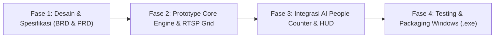

# BUSINESS REQUIREMENTS DOCUMENT (BRD)

**Nama Proyek**: ManyPlayer - Multi-Camera RTSP Monitoring & AI People Counter  
**Target Platform**: Windows OS (Windows 10 / 11 64-bit Desktop Application)  
**Dokumen Versi**: 1.0  
**Tanggal**: 25 Oktober 2026  
**Status**: Approved  

---

## 1. Eksekutif Ringkasan (Executive Summary)

Dalam operasional keamanan gedung, pabrik, pusat perbelanjaan, dan fasilitas umum, pengawasan visual terhadap puluhan titik kamera CCTV (IP Camera) merupakan kebutuhan mendasar. Namun, tantangan umum yang dihadapi saat ini adalah:
1. Kebutuhan memantau puluhan video stream sekaligus (hingga 36 kamera) sering kali membuat aplikasi CCTV desktop biasa menjadi lambat (*lag*), boros memori (*out of memory*), atau bahkan aplikasi mendadak tertutup (*crash*).
2. Kebutuhan penghitungan jumlah lalu lintas manusia (*people counting*) di titik masuk/keluar krusial (seperti lobby utama atau pintu gerbang) umumnya membutuhkan perangkat hardware NVR komersial berbiaya tinggi atau lisensi software analitik berbasis cloud yang mahal.

Proyek **ManyPlayer** hadir untuk menyediakan aplikasi desktop Windows mandiri (*standalone executable*) yang efisien, berdaya guna tinggi, dan mudah dioperasikan. Aplikasi ini mengintegrasikan fungsi **Multi-Grid Video Wall (16, 25, dan 36 kamera)** dengan **AI People Counter (1 atau 2 kamera terfokus)** dalam dua antarmuka (menu) terpisah untuk menjaga efisiensi sumber daya komputer.

---

## 2. Tujuan Bisnis (Business Objectives)

* **Efisiensi Pengawasan Terpusat**: Memberikan kemampuan bagi petugas keamanan untuk memantau hingga 36 titik kamera IP secara simultan tanpa *frame stuttering* yang parah pada perangkat PC kerja standar.
* **Transparansi Arus Pengunjung**: Memberikan visibilitas langsung (*real-time on-screen visibility*) terkait jumlah orang yang masuk, keluar, dan yang saat ini berada di dalam area tertentu tanpa memerlukan infrastruktur server tambahan.
* **Penghematan Biaya Operasional (TCO Reduction)**: Memanfaatkan kamera IP standar berbasis RTSP yang sudah ada di lokasi tanpa keharusan mengganti kamera dengan seri khusus AI berharga mahal.
* **Kemudahan Pengoperasian**: Antarmuka bersih, minim konfigurasi rumit, siap dijalankan langsung di lingkungan Windows tanpa proses instalasi dependensi rumit oleh pengguna akhir.

---

## 3. Profil Pengguna & Pemangku Kepentingan (User Personas & Stakeholders)

| Peran | Profil & Tanggung Jawab | Manfaat dari Sistem |
| :--- | :--- | :--- |
| **Operator CCTV / Satpam** | Bertugas memantau monitor kontrol selama jam operasional. Memerlukan layar grid stabil (4x4, 5x5, 6x6) dan indikator lalu lintas yang mudah dibaca secara visual. | Tidak pusing dengan aplikasi yang sering *freeze*; dapat mengganti mode grid dengan sekali klik. |
| **Manajer Operasional / Pengelola Gedung** | Membutuhkan estimasi kapasitas ruangan dan informasi kerumunan secara instan saat inspeksi lapangan. | Melihat angka pengunjung live di layar pada pintu masuk/keluar dengan angka jelas dan tombol reset harian. |
| **Administrator IT / Teknisi CCTV** | Bertugas mengonfigurasi alamat IP/RTSP kamera dan memastikan perangkat lunak berjalan stabil di jaringan lokal. | Mudah mengedit daftar URL RTSP melalui file konfigurasi sederhana tanpa menyentuh kode program. |

---

## 4. Ruang Lingkup Proyek (Scope of Work)

### 4.1. Dalam Cakupan (In-Scope)
1. **Dukungan Protokol RTSP**: Mendukung koneksi stream RTSP dari berbagai merk IP Camera umum (Hikvision, Dahua, Uniview, Bardi, Ezviz, dll).
2. **Modul Menu 1 - Multi-Grid Video Wall**:
   - Layout 16 Kamera (Grid 4x4).
   - Layout 25 Kamera (Grid 5x5).
   - Layout 36 Kamera (Grid 6x6).
   - Penanganan *Sub-stream* otomatis untuk memastikan komputer tetap ringan.
   - Pemulihan otomatis koneksi RTSP (*auto-reconnect*) jika jaringan sempat terputus.
3. **Modul Menu 2 - AI People Counter (Menu Terpisah)**:
   - Pemilihan tampilan: 1 Kamera (layar tunggal terfokus) atau 2 Kamera (layar ganda / *split screen*).
   - Deteksi berbasis kecerdasan buatan (*AI Object Detection & Tracking*) khusus untuk kategori orang (*person*).
   - Garis virtual lintasan (*virtual tripwire / line crossing*) yang mendeteksi arah Masuk (IN) dan Keluar (OUT).
   - *On-Screen Display (HUD)*: Tampilan angka langsung di atas video (Masuk, Keluar, Estimasi di Dalam).
   - Tombol manual *Reset Counter* untuk mengembalikan hitungan ke angka 0.
4. **Platform Target**: Kompatibilitas penuh dengan sistem operasi Windows 10 dan Windows 11 (64-bit).

### 4.2. Di Luar Cakupan (Out-of-Scope)
* Perekaman video lokal jangka panjang (*continuous 24/7 video recording*) atau fitur *playback* ala NVR penuh.
* Analitik biometrik wajah (*facial recognition*), estimasi gender/usia, atau identifikasi identitas orang.
* Integrasi sistem database relasional skala enterprise (PostgreSQL/Oracle) atau pelaporan terjadwal via email.
* Layanan cloud streaming atau akses publik keluar dari jaringan lokal (aplikasi bekerja murni di jaringan lokal / *on-premise*).

---

## 5. Aturan Bisnis & Batasan Operasional (Business Rules & Constraints)

1. **Pemisahan Beban Komputasi (Decoupling Rule)**:
   - Pemrosesan model AI *People Counter* **TIDAK BOLEH** berjalan di latar belakang saat pengguna sedang berada di Menu Grid Monitoring 36 Kamera, untuk menjaga penggunaan CPU/GPU tetap di bawah batas aman.
   - Proses AI hanya aktif saat pengguna secara aktif membuka Menu *People Counter*.
2. **Kemandirian Data (No-Persistence by Design)**:
   - Sesuai arahan kebutuhan, angka hitungan orang bersifat tampilan langsung (*transient live display*). Tidak diperlukan skema database kompleks yang membebani ruang penyimpanan harddisk PC.
3. **Optimasi Stream Jaringan**:
   - Kamera yang ditampilkan pada menu grid wajib menggunakan resolusi rendah (*sub-stream* misal: 360p / 640x360 @ 10-15 fps).
   - Kamera yang digunakan pada menu people counter dapat menggunakan resolusi menengah/tinggi (*main-stream* misal: 720p/1080p) untuk menjamin akurasi deteksi garis.
4. **Ketahanan Jaringan CCTV**:
   - Jika satu atau beberapa kamera IP mati listrik atau *timeout*, aplikasi tidak boleh menutup paksa (*crash*), melainkan menampilkan visual status "Reconnecting / Offline" pada slot grid tersebut.

---

## 6. Kriteria Keberhasilan Bisnis (Success Metrics / KPIs)

| Metrik | Target Kinerja | Metode Pengukuran |
| :--- | :--- | :--- |
| **Stabilitas Grid 36 Cam** | 0 kali crash dalam 8 jam continuous running pada Windows. | Pengujian reliabilitas jangka panjang di lingkungan Windows. |
| **Penggunaan Sumber Daya** | Konsumsi memori (RAM) stabil tanpa *memory leak* bertahap. | Windows Task Manager monitor. |
| **Akurasi Penghitungan** | $\ge 90\%$ akurasi hitungan pada kondisi lalu lalang normal dengan pencahayaan memadai. | Perbandingan hitungan manual manusia vs angka pada counter di layar. |
| **Kemudahan Penggunaan** | Operator dapat beralih dari Grid 36 ke People Counter dalam waktu $< 2$ detik. | Pengujian operasional UI. |

---

## 7. Rencana Rilis & Fase Proyek

