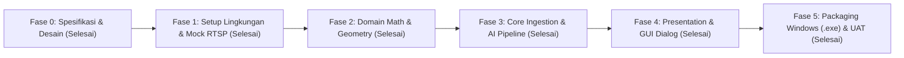

# DEVELOPMENT WORKFLOW & STANDAR OPERASIONAL

**Nama Proyek**: ManyPlayer - Multi-Camera RTSP Monitoring & AI People Counter  
**Target Platform**: Windows 10 & 11 (64-bit Desktop Application)  
**Dokumen**: Panduan Siklus Pengembangan & Protokol Pembaruan Progres  

---

## 1. Siklus Pengembangan Proyek (Development Lifecycle)

Proyek ini dikembangkan secara modular dan terukur melalui 6 fase utama:

---

## 2. Rincian Fase Pengerjaan

### Fase 0: Spesifikasi & Desain Arsitektur (Status: COMPLETED)
- [x] Perumusan kebutuhan bisnis di `DOCS/BRD.md`.
- [x] Spesifikasi fitur fungsional dan teknis di `DOCS/PRD.md`.
- [x] Blueprint rekayasa sistem, multithreading, dan rumus geometri di `DOCS/ARCHITECTURE.md`.

### Fase 1: Setup Lingkungan Kerja & RTSP Mock Simulator (Status: COMPLETED)
- [x] Inisialisasi struktur direktori Lean Clean Architecture (`src/domain/`, `src/core/`, `src/presentation/`, `tests/`).
- [x] Pembuatan `requirements.txt` dan dependensi (PySide6, OpenCV, Ultralytics, NumPy, pytest).
- [x] Pembuatan skrip generator simulasi RTSP (`tests/mock_stream.py` & `scripts/run_rtsp_server.sh`) agar pengujian 16, 25, dan 36 kamera dapat dijalankan tanpa kamera fisik.

### Fase 2: Domain Layer (Pure Python Geometry & Math Engine) (Status: COMPLETED)
- [x] Implementasi geometri segmen berhingga (`src/domain/geometry.py`):
  - [x] `Point`, `LineSegment`, dan evaluasi arah lintasan (Masuk vs Keluar).
  - [x] Algoritma Counter-Clockwise (CCW) Segment Intersection anti false-positive.
- [x] Entitas inti domain (`src/domain/entities.py`): `Camera`, `CounterState`, `TrackedPerson`.
- [x] Layanan garis perpotongan pintu (`src/domain/crossing_service.py`) dengan debounce track ID.
- [x] Automated unit test offline 100% lolos (`tests/unit/test_geometry.py`, `tests/unit/test_crossing.py`).

### Fase 3: Core Video Ingestion & AI Pipeline (Status: COMPLETED)
- [x] Pembuatan modul `src/core/camera_store.py` untuk membaca, menyimpan, dan validasi `config/cameras.json` secara atomik.
- [x] Buffer memori terpusat `src/core/frame_store.py` (`SharedFrameStore`).
- [x] Implementasi `src/core/stream_worker.py`:
  - [x] Isolasi per thread menggunakan `QThread`.
  - [x] Mekanisme *Drop-old-frame* LIFO (buffer 1 frame) untuk *Zero Latency*.
  - [x] Socket timeout 5 detik (`stimeout=5000000`) dan *Auto-reconnect watchdog*.
- [x] Pool worker dinamis `src/core/worker_pool.py` dengan *dynamic throttling* (hanya menjalankan kamera aktif).
- [x] Pipeline deteksi dan tracking AI:
  - [x] `src/core/ai_detector.py` (YOLOv8n kelas person).
  - [x] `src/core/ai_tracker.py` (Centroid tracking dengan bounded trajectory memory).
  - [x] `src/core/analytics_worker.py` (Background thread worker terisolasi dari UI).

### Fase 4: Presentation Layer (PySide6 Native GUI) (Status: COMPLETED)
- [x] Implementasi antarmuka Multi-Grid Monitor (Menu 1):
  - [x] Widget video sel mandiri `src/presentation/widgets/video_tile.py`.
  - [x] Widget grid fleksibel `src/presentation/grid_view.py` (4x4 [16], 5x5 [25], 6x6 [36]).
  - [x] Pull-based Master UI Timer (15 FPS) untuk mencegah *UI freeze*.
- [x] Implementasi antarmuka AI People Counter (Menu 2):
  - [x] OSD HUD angka statistik `src/presentation/widgets/hud_overlay.py` (Masuk, Keluar, Di Dalam).
  - [x] Tampilan fokus / split screen 2 kamera `src/presentation/counter_view.py`.
  - [x] Tombol aksi manual *Reset Counter*.
- [x] Dialog kelola kamera interaktif (`src/presentation/dialogs/camera_config_dialog.py`):
  - [x] CRUD konfigurasi RTSP langsung dari aplikasi tanpa mengedit file JSON secara manual.
  - [x] Uji koneksi RTSP non-blocking.
  - [x] Live reload konfigurasi seketika tanpa perlu me-restart aplikasi.
- [x] State Decoupling: Menidurkan pipeline AI saat berada di Menu 1 untuk efisiensi CPU maksimal.

### Fase 5: Integrasi, Packaging Windows & Pengujian Akhir (Status: COMPLETED)
- [x] Penggabungan seluruh modul di `src/main.py`.
- [x] Konfigurasi PyInstaller bundler (`build_windows.spec`) siap offline YOLO weights.
- [x] Pengujian performa, headless GUI, dan stabilitas (`tests/unit/test_gui_headless.py`).
- [x] Panduan penggunaan dan operasional teknisi di `README.md`.

---

## 3. Protokol Pembaruan Progres Otomatis (`TODO.md`)

Untuk menjaga transparansi dan memastikan progres dapat dipantau oleh pengguna setiap saat:

1. **Aturan Status Tugas**:
   - `[ ]` **Pending**: Tugas belum dimulai.
   - `[▶]` **In Progress**: Tugas sedang aktif dikerjakan oleh asisten AI.
   - `[x]` **Completed**: Tugas telah selesai diimplementasikan dan diverifikasi.
2. **Pembaruan Berkelanjutan**:
   - Asisten AI wajib memperbarui file `TODO.md` setiap kali berpindah tugas atau menyelesaikan suatu modul.
   - Setiap pembaruan status harus menyertakan catatan ringkas tentang apa yang telah diselesaikan.
3. **Validasi Sebelum Selesai**:
   - Tugas tidak boleh ditandai `[x] Completed` sebelum kode diuji dan dipastikan tidak menghasilkan error kompilasi atau runtime.
