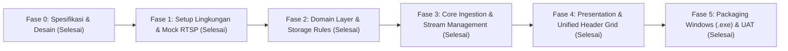

# DEVELOPMENT WORKFLOW & STANDAR OPERASIONAL

**Nama Proyek**: ManyPlayer - Dedicated RTSP Multi-Camera Surveillance Wall  
**Target Platform**: Windows 10 & 11 (64-bit Desktop Application)  
**Dokumen**: Panduan Siklus Pengembangan & Protokol Pembaruan Progres  

---

## 1. Siklus Pengembangan Proyek (Development Lifecycle)

Proyek ini dikembangkan secara modular, terukur, dan ramping (*lean*) melalui 6 fase utama:

---

## 2. Rincian Fase Pengerjaan

### Fase 0: Spesifikasi & Desain Arsitektur (Status: COMPLETED)
- [x] Perumusan kebutuhan bisnis di `DOCS/BRD.md`.
- [x] Spesifikasi fitur fungsional dan teknis di `DOCS/PRD.md`.
- [x] Blueprint rekayasa sistem, multithreading, dan arsitektur di `DOCS/ARCHITECTURE.md`.

### Fase 1: Setup Lingkungan Kerja & RTSP Mock Simulator (Status: COMPLETED)
- [x] Inisialisasi struktur direktori Lean Clean Architecture (`src/domain/`, `src/core/`, `src/presentation/`, `tests/`).
- [x] Pembuatan `requirements.txt` ramping (PySide6, OpenCV, NumPy, pytest) tanpa dependensi berat PyTorch & Ultralytics.
- [x] Template konfigurasi 36 kamera dengan format tunggal `stream_url` (`config/cameras.example.json`).
- [x] Skrip generator simulasi feed RTSP sintetis offline (`tests/mock_stream.py`).

### Fase 2: Domain Layer (Pure Python Entities) (Status: COMPLETED)
- [x] Entitas inti domain (`src/domain/entities.py`): `Camera` (id, name, stream_url) dengan backward-compatible alias.
- [x] Pembersihan total seluruh entitas dan layanan matematika AI yang usang.

### Fase 3: Core Video Ingestion & Stream Management (Status: COMPLETED)
- [x] Modul `src/core/camera_store.py` untuk membaca dan menyimpan `config/cameras.json` secara atomik dan aman.
- [x] Buffer memori terpusat `src/core/frame_store.py` (`SharedFrameStore`).
- [x] Implementasi `src/core/stream_worker.py`:
  - [x] Isolasi per thread menggunakan `QThread`.
  - [x] Mekanisme *Drop-old-frame* LIFO (buffer 1 frame) untuk *Zero Latency*.
  - [x] Socket timeout 3-5 detik dan *Auto-reconnect watchdog*.
  - [x] Pelepasan socket deterministik via `try...finally`.
- [x] In-Process RTSP Bridge (`src/core/rtsp_bridge.py`) untuk penanganan otentikasi ganda kamera Hikvision.
- [x] Dynamic Worker Pool `src/core/worker_pool.py`:
  - [x] *Dynamic throttling* (hanya menjalankan kamera aktif/terlihat).
  - [x] *Deduplikasi & Fan-out cerdas* (1 koneksi fisik jika beberapa slot kamera berbagi URL sama).
  - [x] *Dead worker zombie eviction & automatic recovery*.

### Fase 4: Presentation Layer (PySide6 Native Video Wall) (Status: COMPLETED)
- [x] Implementasi antarmuka Multi-Grid Monitor:
  - [x] Widget video sel mandiri `src/presentation/widgets/video_tile.py` dengan letterboxing/pillarboxing otomatis, OSD smart margin placement, dan border highlight seleksi.
  - [x] Widget grid fleksibel `src/presentation/grid_view.py` (Layout 4x4 [16], 5x5 [25], 6x6 [36]).
  - [x] Pull-based Master UI Timer (15 FPS) untuk mencegah *UI freeze*.
  - [x] Drag & Drop Slot Swapping (penukaran posisi kamera instan tanpa memutus stream RTSP).
  - [x] Mode Fokus (1x1) dan Mode Layar Penuh (Fullscreen F11 / Esc bertingkat).
- [x] Header Terpadu Satu Baris (*Unified Top Header*):
  - [x] Logo branding, status feed, Play/Stop, layout switcher, rasio, OSD, tombol Kelola Kamera, dan Fullscreen tergabung harmonis dalam satu baris toolbar.
  - [x] Eliminasi tombol tab dan widget stack halaman.
- [x] Dialog Kelola Kamera Ringkas (`src/presentation/dialogs/camera_config_dialog.py`):
  - [x] Tabel 3 kolom: `ID Slot`, `Nama Kamera / Lokasi`, `Alamat RTSP Stream URL`.
  - [x] Modal hasil uji koneksi dengan live snapshot preview 16:9 dan kartu diagnostik.
  - [x] Fitur duplikasi baris (*clone row*), pencarian cepat (*live search*), dan live reload tanpa restart.

### Fase 5: Integrasi, Packaging Windows & Pengujian Akhir (Status: COMPLETED)
- [x] Penggabungan seluruh modul di `src/main.py` dengan dukungan mode simulasi `--mock`.
- [x] Konfigurasi PyInstaller bundler (`build_windows.spec`) ultra-ringkas (~30MB binary).
- [x] Pengujian performa, headless GUI, dan stabilitas (`tests/unit/`).
- [x] Panduan penggunaan dan operasional teknisi di `README.md`.

---

## 3. Protokol Pembaruan Progres Otomatis (`TODO.md`)

Untuk menjaga transparansi dan memastikan progres dapat dipantau oleh pengguna setiap saat:

1. **Aturan Status Tugas**:
   - `[ ]` **Pending**: Tugas belum dimulai.
   - `[▶]` **In Progress**: Tugas sedang aktif dikerjakan oleh asisten AI.
   - `[x]` **Completed**: Tugas telah selesai diimplementasikan dan diverifikasi.
2. **Pembaruan Berkelanjutan**:
   - Asisten AI wajib memperbarui file `TODO.md` setiap kali berpindah tugas atau menyelesaikan suatu modul.
   - Setiap pembaruan status harus menyertakan catatan ringkas tentang apa yang telah diselesaikan.
3. **Validasi Sebelum Selesai**:
   - Tugas tidak boleh ditandai `[x] Completed` sebelum kode diuji dan dipastikan tidak menghasilkan error kompilasi atau runtime.
