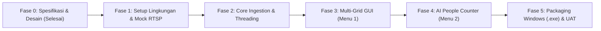

# DEVELOPMENT WORKFLOW & STANDAR OPERASIONAL

**Nama Proyek**: ManyPlayer - Multi-Camera RTSP Monitoring & AI People Counter  
**Target Platform**: Windows 10 & 11 (64-bit Desktop Application)  
**Dokumen**: Panduan Siklus Pengembangan & Protokol Pembaruan Progres  

---

## 1. Siklus Pengembangan Proyek (Development Lifecycle)

Proyek ini dikembangkan secara modular dan terukur melalui 6 fase utama:

---

## 2. Rincian Fase Pengerjaan

### Fase 0: Spesifikasi & Desain Arsitektur (Status: COMPLETED)
- [x] Perumusan kebutuhan bisnis di `DOCS/BRD.md`.
- [x] Spesifikasi fitur fungsional dan teknis di `DOCS/PRD.md`.
- [x] Blueprint rekayasa sistem, multithreading, dan rumus geometri di `DOCS/ARCHITECTURE.md`.

### Fase 1: Setup Lingkungan Kerja & RTSP Mock Simulator
- [ ] Inisialisasi struktur direktori proyek (`src/`, `config/`, `models/`, `scripts/`).
- [ ] Pembuatan `requirements.txt` dan pengecekan dependensi lokal (PySide6, OpenCV, Ultralytics, PyInstaller).
- [ ] Pembuatan skrip generator simulasi RTSP / stream sintetis (`scripts/simulate_rtsp.py`) agar pengujian 16, 25, dan 36 kamera dapat dijalankan tanpa perlu 36 kamera fisik terpasang di awal.

### Fase 2: Core Video Ingestion & Konfigurasi Jaringan
- [ ] Pembuatan modul `src/core/config_manager.py` untuk membaca dan menyimpan `config/cameras.json`.
- [ ] Implementasi `src/core/stream_worker.py`:
  - Isolasi per thread menggunakan `QThread`.
  - Mekanisme *Drop-old-frame* (buffer 1 frame) untuk *Zero Latency*.
  - Pemulihan koneksi otomatis (*Auto-reconnect watchdog*) saat koneksi stream terputus.

### Fase 3: Antarmuka Multi-Grid Monitor (Menu 1)
- [ ] Implementasi widget video sel mandiri (`src/gui/video_cell.py`) lengkap dengan label nama kamera dan indikator status sinyal.
- [ ] Implementasi widget grid (`src/gui/grid_view.py`) yang mendukung pergantian tata letak:
  - Mode 4x4 (16 Kamera)
  - Mode 5x5 (25 Kamera)
  - Mode 6x6 (36 Kamera)
- [ ] Optimasi rasio aspek (16:9) dan konsumsi memori saat merender 36 sel video.

### Fase 4: Antarmuka & AI People Counter (Menu 2)
- [ ] Implementasi modul deteksi objek `src/ai/detector.py` (YOLOv8n / YOLOv11n).
- [ ] Implementasi modul pelacak objek `src/ai/tracker.py` (ByteTrack).
- [ ] Implementasi modul geometri garis lintasan `src/ai/line_counter.py`:
  - Deteksi vektor arah Masuk (IN) vs Keluar (OUT).
  - Mekanisme memori penahan (*debounce / anti double-count*).
- [ ] Implementasi antarmuka `src/gui/counter_view.py`:
  - Pilihan mode 1 Layar Fokus atau 2 Layar Split Screen.
  - Overlay On-Screen Display (HUD) angka Masuk, Keluar, Total di Dalam.
  - Tombol aksi manual *Reset Counter*.
- [ ] Implementasi *State Decoupling*: Mematikan thread AI secara otomatis ketika pengguna berpindah ke Tab Menu 1.

### Fase 5: Integrasi, Packaging Windows & Pengujian Akhir
- [ ] Penggabungan semua modul ke dalam `src/main.py`.
- [ ] Pembuatan skrip konfigurasi PyInstaller (`build_windows.spec`) untuk kompilasi `.exe`.
- [ ] Pengujian performa (stabilitas FPS, kebocoran memori RAM, suhu CPU).
- [ ] Pembuatan panduan penggunaan singkat untuk teknisi/operator.

---

## 3. Protokol Pembaruan Progres Otomatis (`TODO.md`)

Untuk menjaga transparansi dan memastikan progres dapat dipantau oleh pengguna setiap saat:

1. **Aturan Status Tugas**:
   - `[ ]` **Pending**: Tugas belum dimulai.
   - `[▶]` **In Progress**: Tugas sedang aktif dikerjakan oleh asisten AI.
   - `[x]` **Completed**: Tugas telah selesai diimplementasikan dan diverifikasi.
2. **Pembaruan Berkelanjutan**:
   - Asisten AI wajib memperbarui file `TODO.md` setiap kali berpindah tugas atau menyelesaikan suatu modul.
   - Setiap pembaruan status harus menyertakan catatan ringkas tentang apa yang telah diselesaikan.
3. **Validasi Sebelum Selesai**:
   - Tugas tidak boleh ditandai `[x] Completed` sebelum kode diuji dan dipastikan tidak menghasilkan error kompilasi atau runtime.
